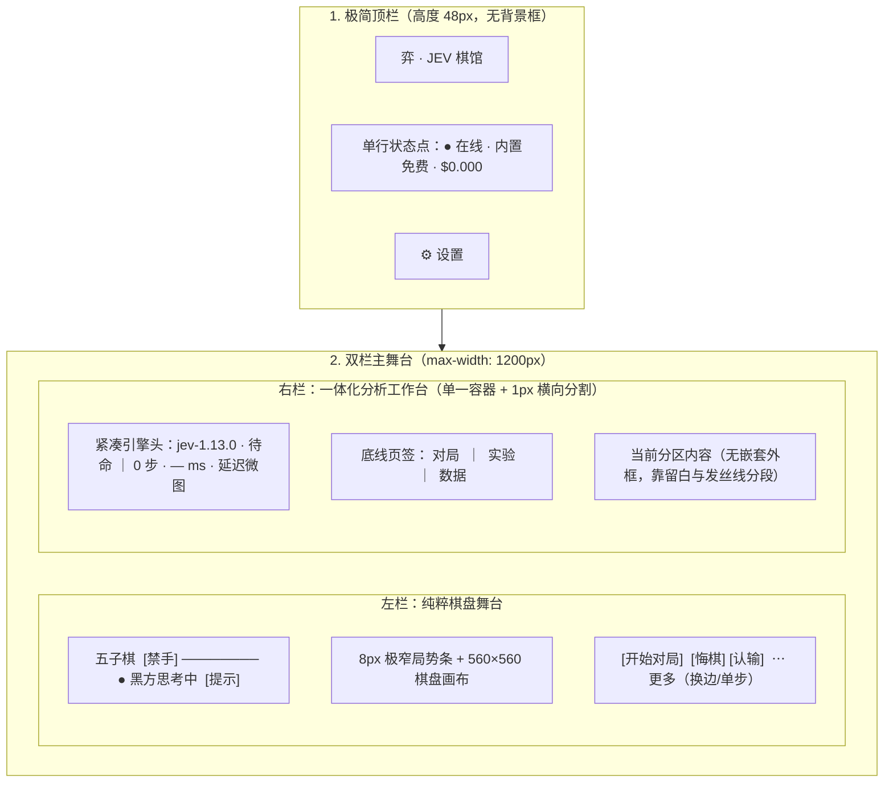

# 前端视觉与交互优化方案：现代、简洁、优雅、去 AI 感

> **状态**：设计方案（已落地为可执行规范）  
> **日期**：2026-11-18  
> **目标**：在不引入任何 UI 框架（保持原生 DOM + TypeScript + 模块化 CSS）的前提下，消除界面中的“AI 生成式模板感”与信息过载，将 Jev 棋馆打磨成兼具**现代专业工具质感（Linear / Lichess 级克制）**与**东方留白美学**的对弈室。

---

## 一、现状诊断：为什么当前界面会有“AI 感”与杂乱感？

通过对 [index.html](../../index.html) 与 [styles/](../../styles/) 四个样式模块的逐行审计，当前界面的“AI 味”并非来自某个单一元素，而是由以下 **5 类典型的 AI 生成式 UI 套路**叠加所致：

| 症结类别 | 当前实现位置 | 具体表现（“AI 感”来源） | 负面影响 |
|---|---|---|---|
| **1. 弥散光晕与厚重浮空阴影** | [tokens.css](../../styles/tokens.css) `--aura-1/2`、`--sh-card`、`--sh-panel` | 页面背景挂了左上冷灰 + 右下朱砂两团巨型径向渐变光球；所有面板挂 `0 10px 30px` / `0 18px 44px` 的宽弥散阴影 | 典型的 AI SaaS 落地页签名；在工具型界面里造成背景发脏、卡片悬浮感过重 |
| **2. 符号与渐变的机械堆砌** | [index.html](../../index.html) `.brand-mark`、`#engineSeal`；[board.css](../../styles/board.css) `button.primary` | 左上角有一枚“弈”字朱砂渐变印章，右栏顶部又有一枚一模一样的“弈”字印章；按钮、局势条、印章普遍使用 `155deg/160deg` 斜向渐变 + `inset` 顶部白高光 | 视觉焦点重复，“中国风元素”沦为贴图式堆砌，缺少真正的东方克制与留白 |
| **3. 盒子套盒子（Card-in-Card）** | [panels.css](../../styles/panels.css) `.panel` 内嵌 `.em` / `.duel-col` / `.big` / `.rs` | 380–430px 宽的侧栏内，外层是带圆角、边框、阴影的 `.panel` 白卡；内部又塞满带圆角、边框、浅灰底的 Bento 小格子 | 边框密度过高，吃掉了原本就不宽的侧栏呼吸空间，满眼都是“方框” |
| **4. 碎片化的字阶与圆角** | [tokens.css](../../styles/tokens.css) 19 档 `--fs-*`、8 档 `--r-*` | 字号从 `10px` 到 `32px` 按 `0.5px` 步进拆了 19 档（`10 / 10.5 / 11 / 11.5 / 12 / 12.5...`）；圆角拆了 `6/7/8/9/10/11/14/999px` 8 档 | 缺乏清晰的排版层级对比，文字大小似变非变，整体秩序感弱 |
| **5. 说明书式的常驻副文案** | [index.html](../../index.html) 各处 `.hint` / `.note` / 长 label | 几乎每个面板和下拉框都跟着一段两三行的括号说明（如“留空 = 跟随全局设置；改动只影响机器方…”、“实验室：棋谱归因/复现的唯一凭据”） | 像把 Prompt 注释直接渲染到了界面上，严重稀释了核心数据的可读性 |

---

## 二、核心设计原则（Design Principles）

1. **表面克制（Flat & Crisp over Glow & Blur）**  
   取消页面角落的彩色氛围光晕（`--aura-*`），将大半径阴影收窄为极轻的贴边微影或纯 `1px` 精确边框，靠**背景（`--bg0`）→ 画布容器（`--bg1`）→ 内嵌微表面（`--bg2`）**三级纯净明度差建立空间层次。
2. **去盒子化（De-boxing：用留白与分割线代替小卡片）**  
   容器内部的数据指标（如成本、Token、决策数、胜率分桶）不再逐个包进独立带边框的小圆角盒子里，改为**无框数字列 + 1px 竖向/横向发丝线（Hairline）**，把空间还给数字本身。
3. **单一视觉锚点（One Hero, One Seal）**  
   **棋盘是全屏唯一的视觉主角**；朱砂红（`--zhu`）与书法展示字（`--font-display`）全屏只在**品牌印记**、**当前落子/思考态**与**关键告警**三处克制点睛，绝不大面积铺陈。
4. **不言自明（Self-Explanatory UI：砍掉 70% 常驻说明文案）**  
   控件本身的表意应当足够清晰；低频解释收纳进标题右侧的 `?` 悬浮提示（`title` / 轻量气泡）或文档中，主界面只留短标签与核心读数。

---

## 三、视觉令牌系统 2.0（`styles/tokens.css` 优化方案）

### 3.1 色彩与表面：更温润的纸墨质感、零光晕污染

在保持 WCAG AA 对比度达标的前提下，将原本偏蓝冷的工业灰微调为更沉静的**宣纸冷灰（Light） / 砚台玄黑（Dark）**，并移除背景渐变光球与浮夸内高光：

```css
:root {
  /* 表面层级：纯色明度差，不用径向彩色光晕 */
  --bg0: #F5F6F8;          /* 桌面基底：温润浅灰，衬托白色主舞台 */
  --bg1: #FFFFFF;          /* 主面板与棋盘衬底 */
  --bg2: #F8F9FB;          /* 次级内嵌区 / 悬停态 */
  --bg3: #ECEFF3;          /* 轨道底色 / 分段控制器槽位 */

  /* 墨色体系（三级足够，严守对比度） */
  --ink: #14171C;          /* 主文字：深墨 */
  --ink-dim: #464E59;      /* 次要文字：中墨 */
  --ink-mute: #666F7B;     /* 辅助标注：淡墨（≥4.5:1） */

  /* 线条体系：结构全靠 1px 实线，废弃散乱虚线 */
  --line: #E6E9EF;         /* 结构分隔发丝线 */
  --line-strong: #D0D6E0;  /* 悬停/强调边线 */
  --line-ctl: #8A94A6;     /* 表单控件边线（≥3:1） */

  /* 双主色：纯色实心优先，不再叠加线性渐变 */
  --mo: #181C22;           /* 玄墨（先手 / 主按钮） */
  --zhu: #BF3B26;          /* 朱砂（后手 / 印记点睛） */
  --ok: #287A4E;           /* 在线 / 校验通过 */

  /* 阴影降噪：砍掉 30~44px 大弥散阴影，只留极轻的微立体边界 */
  --sh-card: 0 1px 3px rgb(20 23 28 / 4%), 0 6px 16px rgb(20 23 28 / 3%);
  --sh-panel: 0 1px 2px rgb(20 23 28 / 3%);
  --sh-btn-hover: 0 1px 3px rgb(20 23 28 / 6%);
}
```

### 3.2 字阶收敛：从 19 档 `0.5px` 碎片收敛为 7 档清晰层级

人类眼睛无法在同一屏幕上分辨 `11px`、`11.5px`、`12px`、`12.5px` 的层级意图。建议在 [tokens.css](../../styles/tokens.css) 中将 19 个变量收敛映射到 **7 个标准字号档位**（向后兼容旧变量名，零破坏迁移）：

| 层级 | 字号 | 行高 | 角色定位 | 映射既有令牌 |
|---|---|---|---|---|
| **Caption** | `11px` | `1.4` | 表头、时间戳、徽标、坐标刻度 | `--fs-micro`, `--fs-cap`, `--fs-xs`, `--fs-sm` |
| **Body-SM** | `12px` | `1.5` | 表单标签、辅助说明、表格数据行 | `--fs-md`, `--fs-read` |
| **Body / UI** | `13px` | `1.5` | 按钮、下拉框、默认正文、状态条 | `--fs-ui`, `--fs-compact`, `--fs-body` |
| **Subhead** | `14px` | `1.4` | 页签、折叠栏标题、着法记号 | `--fs-lead`, `--fs-mv`, `--fs-name` |
| **Title** | `16px` | `1.3` | 面板主标题、抽屉标题、棋种标题 | `--fs-head`, `--fs-title`, `--fs-game` |
| **Brand** | `22px` | `1.2` | 顶栏“JEV 棋馆”品牌名 | `--fs-seal`, `--fs-mark`, `--fs-brand` |
| **Display** | `28px` | `1.1` | 校准技巧分、核心大数字读数 | `--fs-hero` |

### 3.3 圆角收敛：只留 3 档

将原有 8 档圆角统一收敛为：
- `--r-sm: 4px`（色点、进度条、内嵌小块）
- `--r-md: 8px`（按钮、输入框、面板外框、棋盘画布）
- `--r-pill: 999px`（状态胶囊、开关）

> **为什么把面板圆角从 `14px` 降到 `8px`？**  
> `14px~16px` 的大圆角配合厚阴影是移动端卡片流/AI 模板的典型特征；而 `8px` 圆角配 `1px` 发丝边框与棋盘的直角网格在几何语言上更契合，专业感立现。

---

## 四、布局与信息架构重构（Layout & IA）



### 4.1 顶栏（`header`）：从“四个胶囊并排”收敛为“单行呼吸栏”

- **现状问题**：顶栏右侧连摆了 `⚙ 设置`、`后端 检测中`、`渠道 离线演示`、`累计成本 $0.00000` 四个胶囊，每个都有独立边框和底色，视觉零碎。
- **优化方案**：
  1. **品牌区去重**：缩小 `.brand-mark` 至 `28×28px` 纯色朱砂方印（去掉高光阴影与渐变），与标题 `JEV 棋馆` 同行紧凑排列；副标题 `系统一模型 · 五子棋对弈室` 用 `12px` 淡墨色跟在标题右侧（中间以 `·` 分隔），不再上下两行撑高顶栏。
  2. **状态胶囊合一**：三个 `.chip` 去掉各自独立的胶囊外框，合并为一条无边框的等宽字体状态链（中间以 `·` 或 `/` 分隔，`#backendState` 前配一枚 `6px` 状态圆点），最右侧仅保留一个带边框的 `设置` 按钮。

### 4.2 左栏棋盘区（`.board-card`）：把舞台彻底还给棋盘

- **局势条（`.eval-bar`）瘦身**：宽度从 `13px` 收窄至 `6px`，去掉外描边与白虚线中线，仅在 `50%` 处留一个 `4px` 的刻度微痕，玄墨与浅朱砂纯色平滑过渡，像精密仪器侧边的液位计。
- **移出或弱化“战术沿革”**：棋盘正下方的 `<details id="tacticsList">战术沿革</details>` 属于实验室元数据而非对弈操作，夹在棋盘与“开始对局”按钮之间打断了操作流。建议将其移至右栏或底部次级区域；若保留在原位，则改为与 `.status-strip` 同行的右侧轻量文字链 `v14 活三判据纠偏 ▾`，不再单独撑起一块灰色圆角条。
- **控制栏（`.controls`）主次分层**：
  - 主按钮 `#startBtn` 采用纯色玄墨实心（`background: var(--mo)`，去掉斜向渐变和 `brightness(1.18)` 曝光式悬停，改为细腻的 `--mo-hi` 背景过渡）。
  - 次要按钮（`#undoBtn`、`#resignBtn`、`#swapBtn`）采用无底色（或极浅底）轻量描边按钮，按“局中操作”靠右对齐，与左侧“开始/新局”拉开间距。

### 4.3 右栏工作台（`aside.side`）：一体化容器替代“糖葫芦串卡片”

- **现状问题**：右栏由顶部的 `.engine-panel` + `.side-tabs` + 下方多个 `.panel` 组成，每个 `.panel` 都是独立的圆角白卡片，中间隔着 `10px` 灰色背景缝隙；滚动时卡片边缘与阴影互相切割。
- **优化方案**：
  1. **引擎面板（`.engine-panel`）紧凑化**：
     - **去掉第二个“弈”字印章（`#engineSeal`）**：左上角品牌区已有“弈”字印记，右栏无需再盖一章。
     - 将原本占两行的 4 个 `.em` 方块（本次成本、输入 token、决策数、最快/最慢）改为**单行无框四列读数（以 `1px` 竖向发丝线分隔）**，高度压缩 45%。
  2. **页签栏（`.side-tabs`）改为经典分段槽或底线页签**：
     - 去掉外层粗边框，采用 `background: var(--bg3); padding: 2px; border-radius: var(--r-md)` 的内嵌分段槽，选中态为纯白底色（`--bg1`）+ 极轻阴影，未选中态为纯文字，干净利落。
  3. **面板群“去卡片化”**：
     - 将 `#pane-play` / `#pane-exp` / `#pane-data` 本身作为一个完整的白色圆角容器（`background: var(--bg1); border: 1px solid var(--line); border-radius: var(--r-md)`）。
     - 内部的各个 `.panel` **去掉独立外边框、圆角与外部阴影**，改用 `border-bottom: 1px solid var(--line)` 横向发丝线自然分段！这样整个右栏从“五六个挤在一起的小盒子”变成了一张**平整、连贯、呼吸感极强的专业仪表盘页面**。

---

## 五、关键组件微观打磨清单（Micro-Interactions & Components）

### 5.1 表单与设置（对局设置 / 对手配置 / 全局抽屉）
- **现状**：`label` 独占一行，`select` 紧跟在下一行且 `width: 100%`，导致三个简单选项（模式、执子、速度）就要占掉近 `200px` 高度。
- **优化**：在侧栏与抽屉中全面采用**左右内联键值行（Inline Row）**：
  ```css
  .panel-body > label {
    display: grid;
    grid-template-columns: 72px 1fr;
    align-items: center;
    gap: var(--sp-3);
  }
  ```
  左侧固定 `72px` 放置淡墨色字段名，右侧放置紧凑型 `select/input`（高度 `30px`），表单垂直空间立即节省 **50%**，且视觉对齐如刀裁般整齐。

### 5.2 实时胜率与判断趋势图（`src/ui/charts.ts` + `styles/panels.css`）
- **去网格噪点**：隐藏或极度淡化水平网格线（仅保留 `50%` 均势基准线），让折线本身成为唯一视觉中心。
- **笔触精炼**：`.trend-line` 线宽从 `2px` 微调为 `1.75px`；曲线下方可叠加一层极淡的 `4%` 墨色面积渐变（Area Fill），增强“局势厚薄”的直觉感知。

### 5.3 决策候选榜与决策流（`src/ui/panels/cockpit.ts`）
- **候选榜（`#latestRanks`）**：将概率条高度从 `5px` 压至 `3px`，作为行底部的精致饰线或右侧窄条；第一候选（`.is-chosen`）用玄墨实心，其余候选仅用浅灰，拉开首选与备选的视觉权重。
- **决策流（`#feed`）**：去掉每条决策记录四周的圆角卡片边框，改为**时间轴/棋谱式纯文本流**（左侧手数 `#12` 等宽右对齐 + 中间着法坐标 `H8` 加粗 + 右侧胜率与耗时），扫描效率提升一倍。

### 5.4 数据表格（战绩簿 / 排行榜 / 开局库 / 归档）
- 统一采用 **“无竖线、细横线、等宽数字右对齐”** 的现代金融/竞技数据表规范。
- 去掉所有表头胶囊背景，表头仅用 `11px` 淡墨色文字 + `border-bottom: 1px solid var(--line-strong)`。

---

## 六、分阶段实施路线图与验收口径

为确保**零回归**（完全兼容现有 `test/ui/index-shell.spec.ts` 的 `REQUIRED_IDS` 与 `test/ui/layout-css.spec.ts` 的双栏网格断言），建议分两步无损落地：

### Phase 1：纯样式层“去 AI 感”换肤（零 HTML / TS 改动，风险最低）
- **改动范围**：仅修改 `styles/tokens.css`、`styles/layout.css`、`styles/board.css`、`styles/panels.css`。
- **核心动作**：
  1. 移除 `--aura-1` / `--aura-2` 背景光球，切换为纯净宣纸灰底色 `--bg0`；
  2. 收敛字阶至 7 档、圆角至 3 档，削减 `--sh-card` / `--sh-panel` 阴影浓度 70%；
  3. 移除 `button.primary`、`.brand-mark`、`.eval-bar` 的斜向高光渐变，改为克制的纯色平面；
  4. 将右栏 `.panel` 改为扁平分割线式布局，将 `.em` / `.duel-col` / `.big` 去盒子化；
  5. 将表单 `label > select` 改为左右内联网格行，隐藏 `#engineSeal` 重复印章。
- **验收标准**：`npm test` + `npm run build` + `npm run check:docs` 全绿。

### Phase 2：文案精简与结构微调（HTML + UI 视图层）
- **改动范围**：`index.html`、`src/ui/panels/settings.ts`、`src/ui/panels/cockpit.ts`。
- **核心动作**：
  1. 精简各面板常驻 `.hint` 说明书式长句，收纳进 `title` 提示；
  2. 顶栏状态胶囊去框合一；
  3. 候选榜与决策流列表轻量化排版。
- **验收标准**：同步更新对应 UI 快照/断言，`npm test` 全量通过。
